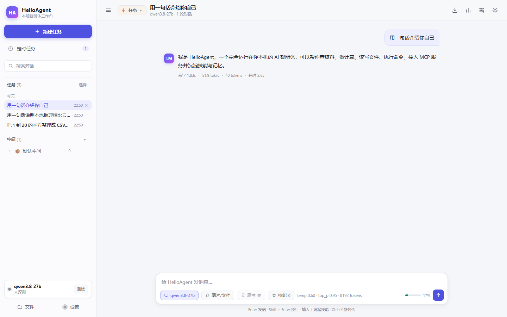
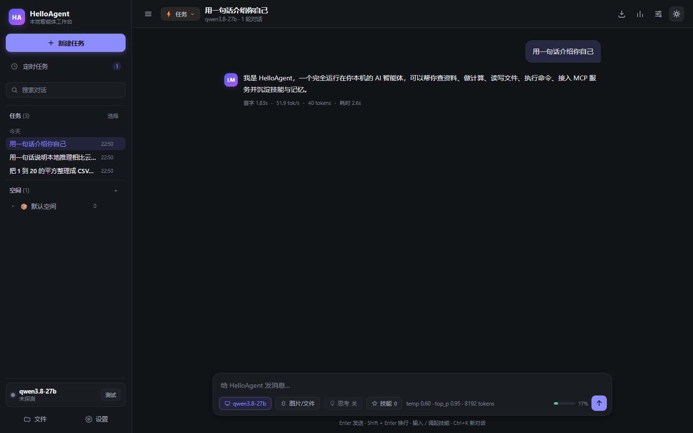
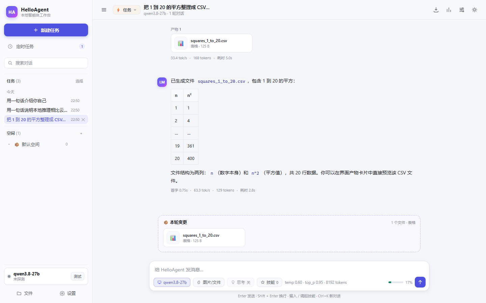
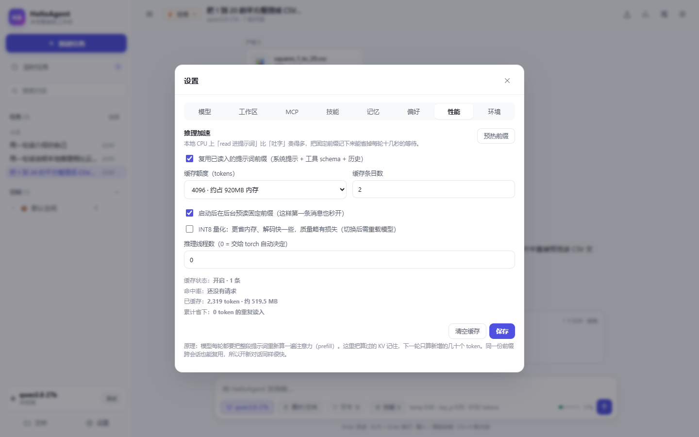
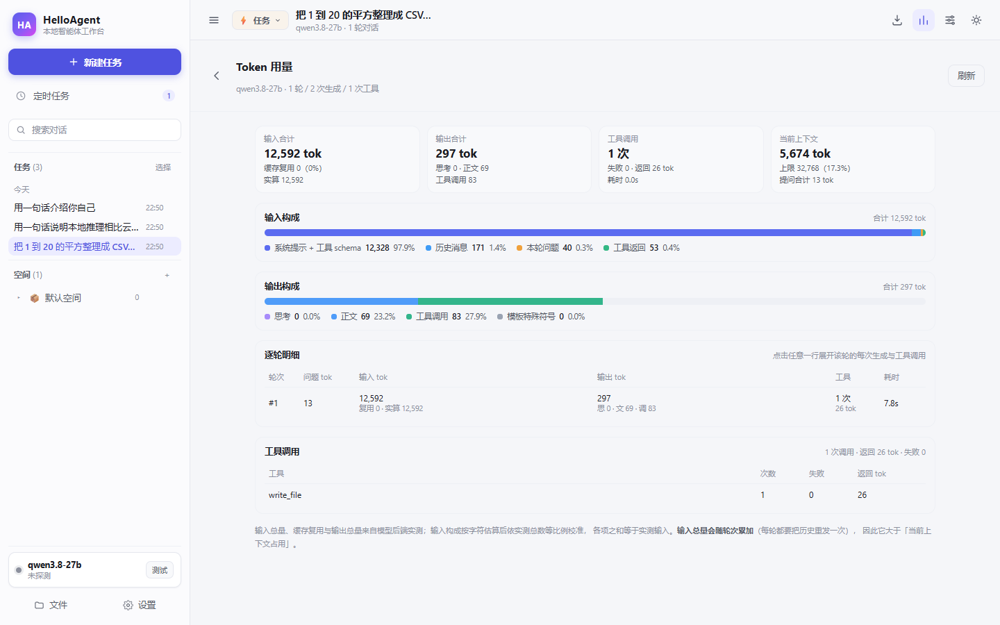

# HelloAgent · 本地智能体工作台

一个完全跑在自己电脑上的 AI 智能体：模型权重本地加载推理，对话、文件、记忆全部留在本机，不依赖任何云端服务。
除了聊天，它还能**读写工作目录里的文件、执行命令、调用 MCP 工具、按技能干活、自己记事**。

- **模型自选**：本地 transformers（Qwen3 系列）或任意 OpenAI 兼容端点（LM Studio / Ollama / vLLM / 云端 API）
- **产物落地**：生成的文件就在工作目录里，右侧分屏直接预览，改动实时可见
- **数据自持**：会话存 SQLite、记忆是一份 Markdown、配置是 JSON，全在 `data/` 下，随目录搬走

| 浅色主题 | 暗色主题 |
| --- | --- |
|  |  |

## 快速开始

```bat
:: 1. 装依赖（先激活你的环境：conda activate 环境名 / .venv\Scripts\activate）
python -m pip install -r requirements.txt

:: 2. 启动（默认 127.0.0.1:8765，自动打开浏览器）
python run.py

:: 或直接双击 start.bat —— 会自动挑一个装了依赖的解释器
```

依赖分两组：`fastapi / uvicorn / httpx / pydantic` 是服务必需；`torch / transformers / accelerate / safetensors`
只给本地推理用。**只用 LM Studio、Ollama 或其它 OpenAI 兼容端点的话，第二组可以不装**（省 2–3GB）。

**准备模型**：权重不入库，首次使用在「模型」面板的**模型库**里选来源（ModelScope / HF 镜像），
搜 `Qwen/Qwen3-0.6B`、`Qwen/Qwen3-1.7B` 等仓库下载；也可以把自己下好的权重直接放进 `models/`。
下载完成后首次对话自动加载（默认 Qwen3-0.6B，CPU 约 10 秒）。

| 启动参数 | 说明 |
| --- | --- |
| `--port 9000` | 指定端口（被占用时自动向后寻找） |
| `--host 0.0.0.0` | 允许局域网访问 |
| `--no-browser` | 不自动打开浏览器 |
| `--reload` | 开发模式，代码热重载 |

## 界面速览

界面三栏：左侧任务 / 空间与对话列表，中间对话区，右侧文件面板与预览。输入框下方一排是
`模型`（点开切换）、`图片/文件`、`思考`（开关 + 轻度/标准/深入）、`技能`（勾选本轮启用的技能）。

- **`/` 调起技能**：输入框敲 `/` 弹出候选（按 slug / 名称 / 描述过滤，↑↓ + Enter 选择），
  选中的 `/技能名` 留在原位，发送时改写成「【使用技能：xx】」注入那句话的语义位置，本轮强制启用；
  没匹配到的 `/xxx`（路径、URL）原样保留。
- **生成中继续打字**：模型回答时输入框不禁用，按 Enter 是把消息**加入队列**（可排序、改文字、删除、插队），
  当前这轮结束后按顺序发送。
- **切换会话不打断生成**：A 会话生成时可以随时切到 B，侧边栏里 A 带呼吸灯；切回来会重放已产生的内容接着看。
- **文件面板**：右侧抽屉，按文件系统结构展示当前工作目录的目录树，点文件夹展开、点文件预览，
  也能上传文件、在文件管理器里打开目录。
- **预览是右侧分屏，不是弹窗**：**支持同时打开多个文件**，顶部一排标签，点标签切换、✕ 或中键关闭，
  关掉最后一个面板自动收起。Markdown / HTML / CSV 有「预览 / 源码」切换，拖左边缘可调宽度（会记住）。
- **任务与空间**：侧边栏分两组。任务是一句话开始的对话；空间是一行文件夹，点箭头展开里面的对话，
  点名字切换工作目录。行尾「⋯」可以改名、打开目录、移除。
- **产物卡片**：每条回答下面列出这轮生成 / 改动的文件，一轮结束还有「📦 本轮变更」汇总，刷新后也能回看。
- **多模态输入**：输入框左侧「图片/文件」，或直接把图片粘贴、拖进输入框。
- **顶栏**：导出会话为 Markdown、Token 用量、会话参数、明暗主题。
  快捷键：`Ctrl+K` 新建对话、`Ctrl+J` 切换思考、`Ctrl+Shift+O` 文件面板、`Esc` 关闭弹窗。

## 核心能力

### 1. 思考模式：开关 + 强度

- 本地后端采用**两段式生成**：先按预算生成思考过程并流式输出，达到预算后截断，
  把已生成内容接回提示词再生成正式回答——所以「深度思考」不会无限跑下去。
- 强度对应的思考预算（约）：轻度 320 / 标准 900 / 深入 2400 tokens。
- OpenAI 兼容端点按模型自动选择控制字段：Qwen 系走 `chat_template_kwargs.enable_thinking`，
  o 系列 / DeepSeek 走 `reasoning_effort`，也可在模型档案里手动指定。
- 思考过程以「思考过程」折叠块展示，流式打印；被预算截断时标注「已达思考预算，转入回答」。

### 2. 上下文压缩

- 输入框右侧实时显示上下文占用（已计入工具 schema 的体积，不是只算聊天文本）。
- 超过阈值（默认 75%）自动压缩：把较早消息交给同一个模型总结成结构化摘要，写回会话，
  提示词里用它替换那部分历史。
- **原始消息不会删除**，界面上仍可回看；后续压缩会把已有摘要滚动合并，不会丢更早的信息。
- 也支持手动压缩：点上下文占用条 →「压缩上下文」，或 `POST /api/conversations/{id}/compact`。
- 摘要没让上下文变短时（短对话常见）自动压缩会跳过，不做无用功。

### 3. 任务与空间

切换工作位置等于切换模型看到的工作目录：

| | 任务 | 空间 |
| --- | --- | --- |
| 是什么 | 直接开始的对话 | 有名字、可长期复用的工作目录 |
| 工作目录 | 默认空间下**每个对话一个目录**：`workspace/chats/<会话名>-<id>/` | 你自己指定的目录（对话共用） |
| 适合 | 问一句、跑个脚本、临时生成点东西 | 一个代码仓库、一个客户资料库、一个长期写作目录 |
| 管理 | 不用管，就是一个对话列表 | 侧边栏可见，可改名 / 图标 / 说明、在文件管理器打开、移除 |

- **新建空间**两种方式：在某个父目录（默认项目目录）下**新建文件夹**，或**关联已有的本地文件夹**
  （不移动、不复制任何文件）。
- 空间可以写一段**空间说明**（如「草稿放 drafts/，文件名用 客户-日期」），随系统提示词注入。
- 定时任务有独立目录（`schedules/<任务名>/`），不出现在空间列表里，只出现在「定时任务」页。

所有文件读写与命令执行都收敛到「当前工作目录」，路径解析只有一个守卫：

- 模型只能访问当前工作目录内部，`../`、绝对路径越界一律拒绝；
- 命令固定 cwd 在当前目录，默认 30s 超时（最大 300s），输出超长截断，明显破坏性的命令直接拦截；
- 上传 / 下载 / 预览走同一套路径校验，前端拿不到目录外的文件；
- 关联的真实目录完全按原结构使用，不会硬塞 `outputs/` 之类的子目录。

内置工具：`list_files`、`read_file`、`write_file`、`edit_file`、`search_files`、`make_dir`、
`delete_file`、`run_command`、`run_python`、`workspace_info`。

> 这是「受限目录 + 超时 + 拦截」的实用沙箱，不是内核级隔离。跑完全不可信的代码请上容器或虚拟机。

### 4. 技能（Skills）

技能是一份带 frontmatter 的 Markdown，描述某类任务怎么做：

```
skills/<slug>/SKILL.md
---
name: 代码审查
description: 按固定清单审查代码，输出可执行的问题列表
tags: [code, review]
---

# 执行步骤
1. ...
```

- 系统提示词里只列**技能目录**（名称 + 一句话说明 + 路径），正文按需加载，不浪费上下文。
- 模型通过 `use_skill` 加载正文；用户勾选技能（或敲 `/` 选）时正文在本轮直接注入。
- 模型可以自己 `skill_create` / `skill_update` / `skill_delete`——说「把刚才这套流程存成技能」即可，
  写入的 `SKILL.md` 会以产物卡片实时展示。
- 技能变更后界面里的列表（勾选面板 / `/` 候选 / 设置页）自动刷新。
- 自带两个示例技能：`code-review`、`data-report`，只播种一次，删掉后重启不会自己长回来。

### 5. 多模态输入与产物卡片

**输入侧**：图片 / 文档先落盘到工作目录 `uploads/日期/`，消息里只存元数据（不把 base64 塞进数据库）。
按模型能力分三条路：

| 模型 | 图片 | 文本类附件（md / 代码 / csv…） |
| --- | --- | --- |
| OpenAI 兼容端点（默认 `auto`） | 转 `image_url` data URL 真发过去；后端不吃图会自动剥掉改成文字说明并重试一次 | 内容直接内联进提示词（单文件上限 12000 字符） |
| 本地 transformers | 降级成一句路径说明，不影响请求 | 同上 |

- 模型档案里可指定「图片输入」：自动 / 支持看图 / 纯文本。
- 历史消息里的旧图不会每轮重发（最多保留最近 6 张），token 估算按图计价。
- 30MB 以内任意文件都能传，模型之后可以用 `read_file` 等工具继续访问。

**输出侧**：`GET /api/conversations/{id}/artifacts` 把会话里生成过 / 提到过的文件整理成清单，
按「哪条消息产的」归属。点击卡片在右侧分屏预览：

- `.md` → marked 渲染（表格 / 代码高亮 / 复制按钮）
- `.html` → 在 sandbox iframe 里真实运行（脚本可跑，但拿不到主页面接口权限）
- `.csv / .tsv` → 渲染成表格（表头吸顶，最多 500 行）
- 代码 / 文本 → 语法高亮；图片 → 直接显示
- 所有类型都能切「源码」、下载或新窗口打开


*工具调用卡片（参数、返回、耗时）与「📦 本轮产物」汇总，点卡片在右侧分屏预览*

### 6. MCP 接入

MCP（Model Context Protocol）服务连上后即可被模型调用，异步执行、进程内长连接复用。

**默认「按需发现」而不是全部内联**：模型先 `mcp_list_tools(name=服务名)` 拿到工具名与参数 schema，
再 `mcp_call_tool(name=…, tool=…, arguments=…)`。原因是金融、浏览器这类 MCP 动辄上百个工具，
全量内联会把提示词撑到两万 token——CPU 上光读入就要三分钟。工具少、希望模型直接调时，
可在「设置 → MCP」底部打开内联开关，工具会以 `mcp__<服务名>__<工具名>` 出现在工具表里。

配置固定在 `data/mcp.json`：

```json
{
  "servers": {
    "filesystem": {
      "transport": "stdio",
      "command": "npx",
      "args": ["-y", "@modelcontextprotocol/server-filesystem", "<项目绝对路径>/workspace"],
      "env": {"GITHUB_TOKEN": "${GITHUB_TOKEN}"},
      "enabled": true,
      "auto_start": true,
      "description": "本地文件读写"
    },
    "remote-demo": {
      "transport": "http",
      "url": "https://example.com/mcp",
      "token": "${MCP_TOKEN}",
      "headers": {"X-API-Key": "xxx"},
      "auto_start": false
    }
  }
}
```

三种接入方式效果一样：「设置 → MCP → 添加服务」图形界面；直接改 `data/mcp.json` 后点重连；
或者对模型说「帮我接入 filesystem 这个 MCP，工作区目录是 …」，它用 `mcp_add_server` + `mcp_connect` 自己配好。

**鉴权**：

| 方式 | 字段 | 说明 |
| --- | --- | --- |
| Bearer 令牌 | `token` | 自动加 `Authorization: Bearer <token>` |
| 自定义请求头 | `headers` | 任意头，如 `X-API-Key`、租户头 |
| 子进程环境变量 | `env` | stdio 服务的环境变量，API Key 走这里 |
| 环境变量占位符 | 任意字段写 `${VAR}` | 从系统环境变量读取，密钥不落到配置文件 |

点「测试连接」会用**当前未保存的表单**试连，返回工具数量与耗时；失败给出可读原因
（401/403 明确指出鉴权失败、404 提示路径前缀、连接失败提示代理或地址）。列表里的密钥打码显示，
再次保存不会把打码值覆盖成真实配置。

**工具调试面板**（设置 → MCP → 某一行「工具」）：左侧拉取并刷新工具列表（`tools/list`），
右侧显示说明与 `inputSchema`，参数框按 schema 自动生成模板，改完点「调用」，
返回内容、`structured_content`、是否报错、耗时一目了然。

仓库自带示例服务：

```bat
:: stdio 示例：设置 → MCP → 添加服务，命令填 python.exe 路径，参数填 examples/mcp_echo_server.py
python examples/mcp_echo_server.py

:: 带 Bearer 鉴权的 http 示例（另开一个终端）
set MCP_TOKEN=secret-token-123
python examples/mcp_http_auth_server.py
:: 界面里添加：传输 http、地址 http://127.0.0.1:8790/mcp、访问令牌 secret-token-123
```

### 7. 自记忆（跨会话）

- 记忆文件固定在 `data/memory/MEMORY.md`，按「用户偏好 / 项目约定 / 事实与决定」分段。
- 每次请求都会注入系统提示词（可设上限），模型能长期记住你的偏好与项目背景。
- 模型通过 `memory_save` / `memory_forget` / `memory_read` 自己维护；用户纠正时先删旧再记新。
- 「设置 → 记忆」里可以直接编辑，或一键清空。

### 8. 推理加速（前缀 KV 缓存）

本地 CPU 上「把提示词读进模型」（prefill）比「吐字」（decode）贵得多：一段典型对话每轮固定带着
系统提示 + 工具 schema 约 4000 token，而 0.6B 模型在 12 代酷睿上 prefill 只有约 200 tok/s——
也就是**每轮光读入就要 20 秒**，哪怕你只问了一句「你好」。

`app/llm/kv_cache.py` 把算过的 KV 记住，下一轮只算新增的几十个 token：

| 场景 | 优化前首字 | 优化后首字 |
| --- | --- | --- |
| 同一会话第 2 轮起 | ~28 s | **~1.3 s** |
| 换一个会话问第一句 | ~20 s | **~2.5 s**（共享同一段系统提示前缀） |
| 开启思考模式 | 第二段要把「提示词 + 思考内容」重新读一遍 | 接着第一段的 KV 往下写，第二段 prefill 为 0 |

实现要点：

- **只按 token 前缀复用**：与新提示词求最长公共前缀，任何 token 不一致就退回全量 prefill，结果等价。
- **易变内容后置**：当前时间、工作区文件清单放在提示词**末尾**的独立 system 消息里
  （`agent.build_volatile_prompt`）。否则一个秒级时间戳就能让后面 4000 token 全部作废。
- **提示词只 encode 一次**：统一走 `Engine.tokenize`。
- **启动预热**：模型加载完后在后台把固定前缀先 prefill 好（分块进行，用户发消息时让出 CPU），
  第一条消息也是秒开。前缀超过 8000 token 会跳过预热（说明工具内联太多，先把内联关掉）。
- **预算可控**：`perf.cache_tokens`（默认 4096，约 920MB）、`perf.cache_entries`（默认 2）。

「设置 → 性能」里可以开关、调额度、手动预热 / 清空，并看到命中率与累计省下的 token。


*「设置 → 性能」：缓存额度、条目数、命中情况与累计省下的 token*

关于**蒸馏**：那是训练侧的事（拿大模型输出重训小模型），对已经在本机跑着的这个模型没有帮助。
真正能让这台机器变快的是：前缀缓存、INT8 量化（设置里可开，约 1.2–1.7 倍）、
少生成点 token（思考预算 / 最大回复长度）、以及别把上百个 MCP 工具塞进提示词。

### 9. Token 用量面板

顶栏柱状图按钮打开**整页**（聊天区让位、左上角返回、Esc 退出），看的是**当前会话**的 token 账本
（数据来自 `/api/conversations/{id}/usage`）：

- **概览**：输入合计（含缓存复用与实算）、输出合计、工具调用、当前上下文占用
- **输入构成**：系统提示 + 工具 schema / 历史消息 / 本轮问题 / 工具返回
- **输出构成**：思考 / 正文 / 工具调用 / 模板特殊符号
- **逐轮明细**：一次用户提问算一轮，展开可看该轮每次生成（首字、tok/s、复用与实算）与每次工具调用
  （成功与否、参数与返回 token、返回内容预览、耗时）
- **工具排行**：每个工具的调用次数、失败数、累计返回 token


*概览四卡 + 输入/输出构成条 + 可展开的逐轮明细与工具调用记录*

口径（面板底部也有说明）：

- 输入总量、缓存复用、输出总量来自后端**实测**；输入四项构成按字符估算，用「可变部分最小的一次生成」
  反推固定开销系数校准，四项之和恒等于实测输入。
- **输入总量按轮累加**：每轮都要重发历史，所以它远大于「当前上下文占用」。
- 输出三分项由本地后端按 tokenizer 切分统计；接 OpenAI 兼容后端时退化为文本估算。

### 10. 多会话并行 · 消息队列 · 定时任务

生成与 HTTP 连接是解耦的（`app/runs.py`）：每次生成是一个后台 Run，事件带自增 `seq` 缓存在内存里，
SSE 断开（切会话、刷页面）只是「不看了」，回来用 `/api/runs/{id}/stream?from_seq=0` 重放接着看。

- **并行粒度**：本地 transformers 后端一次只能算一个（单引擎一把 `gen_lock`），同时只跑一个 Run，
  其它排队等槽位；OpenAI 兼容端点按 `perf.parallel_runs`（默认 2）真正并行。
- **消息队列**：会话忙时继续发消息进入队列，当前轮结束自动按序开跑；支持排序 / 编辑 / 删除 / 插队。
  队列在内存里，重启清空。
- **定时任务**（`app/scheduler.py` + `schedules` 表）：once / daily / weekly / every 四种规则，
  10 秒粒度触发。每个任务在 `schedules/<任务名>/` 下有同名目录，**每次触发都新建一个对话**挂在下面，
  产物写进 `runs/<日期时间>/`，各次执行互不覆盖，历史可逐条回看。
  时间规则来自 `app/schedule_parse.py` 的本地解析，也支持一句话创建，模型侧有
  `schedule_create / schedule_list / schedule_delete / schedule_toggle` 四个工具。

### 11. 其它

- 多会话、自动标题、搜索（标题 + 内容）、置顶排序
- SSE 流式输出、TTFT / tok/s / token / 缓存命中统计、真正中断生成、重新生成
- 工具执行过程以可折叠卡片展示参数与返回值，MCP 工具同样适用
- Markdown + 代码高亮 + 复制，明暗主题，渲染库已本地化（离线可用）
- 对话导出为 Markdown

## 目录与数据

这些路径会写进系统提示词，模型自己知道东西放在哪：

| 用途 | 路径 |
| --- | --- |
| 任务目录（直接执行） | 项目根目录 |
| 空间目录 | 用户创建 / 关联的任意本地目录 |
| 技能库 | `skills/` |
| 模型权重 | `models/` |
| MCP 配置 | `data/mcp.json` |
| 长期记忆 | `data/memory/MEMORY.md` |
| 会话数据库 | `data/chat.db` |
| 配置 | `data/config.json` |
| 会话产物 | `workspace/` |

`data/`、`models/`、`workspace/` 属于本机数据，不随仓库分发。所有路径都基于项目根目录推导，
整个目录可以整体搬到别的机器或别的用户名下。

## 代码结构

```
app/
  main.py          FastAPI 路由：会话 / Run 流 / 队列 / 定时任务 / 空间 / 文件 / 技能 / MCP / 记忆
  agent.py         提示词装配、上下文压缩、多轮工具循环
  runs.py          后台运行管理：Run 与 HTTP 解耦、事件重放、槽位并发、消息队列
  scheduler.py     定时任务调度（10s ticker；每次触发新建对话并落在任务目录）
  schedule_parse.py「每天 9:00 / 每周一 10:30」等自然语言时间规则解析
  context.py       token 估算、摘要生成、切割策略
  usage_report.py  会话 token 用量账本（逐轮 / 汇总 / 工具）
  settings.py      配置、固定路径、默认值
  store.py         SQLite 会话、消息、空间与定时任务（含列迁移）
  spaces.py        任务/空间：目录解析、空间 CRUD、文件夹选择、旧数据迁移
  workspace.py     工作目录路径守卫、文件树、读写删、搜索
  sandbox.py       命令 / Python 执行：超时、截断、危险拦截
  skills.py        技能解析与 CRUD
  multimodal.py    多模态输入（附件落盘 / 图片编码 / 提示词组装）与产物元数据
  mcp_client.py    MCP 连接管理、工具动态注册
  memory.py        长期记忆读写
  runtime.py       contextvars 传递本轮会话/工作目录
  llm/             local_hf（两段式思考 + 前缀 KV 缓存）、kv_cache、openai_compat、流式解析
  tools/           basic / files / meta 三组工具 + 异步注册表
web/               原生 JS 前端（index.html / style.css / app.js）
examples/          示例 MCP 服务
docs/screenshots/  README 界面截图
scripts/           基准与自检脚本（bench_* / probe_cache / ui_check）
skills/            技能库，每个技能一个 SKILL.md
start.bat          Windows 启动器
llm-tool.py        独立演示脚本：下载模型 + 直接跑一次带工具调用的推理
```

关键设计：**工具统一异步执行**（`aexecute`），同步内置工具丢线程池、MCP 工具走长连接；
**路径只有一个入口**（`workspace.resolve`），越界在源头拒绝而不是每个工具各写一遍。

## 排错

| 现象 | 原因与处理 |
| --- | --- |
| `ModuleNotFoundError: No module named 'uvicorn'` | 启动用的解释器没装依赖。激活装了依赖的环境后再 `python run.py`，或把该解释器路径写进项目根的 `.python-path`（一行，`start.bat` 会读取） |
| 提示「未检测到 torch」 | 只影响本地推理。要本地跑模型就装 `requirements.txt` 里那组 torch 依赖，否则改用 LM Studio / Ollama 等 OpenAI 兼容端点即可 |
| 端口被占用 | 会自动向后找空端口；也可以 `--port 9000` 指定 |
| 模型列表为空 / 加载失败 | `models/` 是空目录，去「模型」面板的模型库下载，或把已有权重放进去 |
| 想让局域网访问 | `--host 0.0.0.0` 启动，同时确认防火墙放行 |

## 安全说明

- 服务默认只监听 `127.0.0.1`；用 `--host 0.0.0.0` 暴露到局域网前请自行评估。
- 文件访问限制在当前工作目录内；命令执行有超时与危险命令拦截，但**不构成强隔离**。
- `data/` 里有对话记录与配置（`mcp.json` 可能含令牌），`models/` 是大体积权重，
  `workspace/` 是会话产物——这些都不应提交到公开仓库。

## 已知限制

- 本地 0.6B 模型在 CPU 上解码约 9 tok/s（受内存带宽限制，INT8 可到 12–13 tok/s），
  更大的模型或 GPU 会快很多（模型档案里改设备 / 精度）。
- 本地后端同一时刻只跑一个 Run，其它会话请求排队等槽位，界面上能看到「排队中」；
  OpenAI 兼容端点可以真并行。
- 消息队列保存在内存里，重启服务会清空（定时任务在 SQLite 里，不受影响）。
- 前缀缓存只加速「读提示词」，不加速「吐字」；长回答本身还是要等，可用思考预算 / 最大回复长度控制。
- 缓存的 KV 约 224KB/token（0.6B fp32），额度调大要看内存，超了按 LRU 淘汰。
- 小模型的工具调用与摘要质量有限，复杂任务建议配 3B 以上的模型。
- 上下文估算是启发式的（中英混排按字符折算），与真实 tokenizer 有 5–15% 偏差，用于触发压缩足够。
- 本地 transformers 后端走纯文本管线，图片会降级成文字说明；要真正看图请配支持多模态的 OpenAI 兼容端点。
